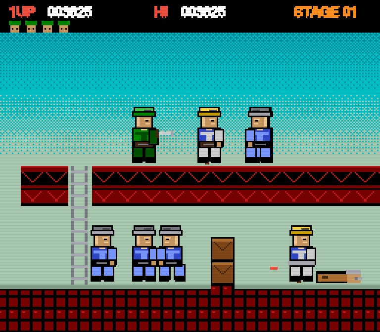

# KNIFE & LADDER

一个 256×224 的横版卷轴像素小游戏，**渲染层是自己写的帧缓冲**——没有 Canvas 绘图 API，没有精灵图，没有引擎，一个 HTML 文件跑完。

致敬 1985 年那类街机横版动作游戏（钢盔、刺刀、双层桥面和梯子），但美术、关卡、代码全部原创。



## 玩

直接用浏览器打开 `index.html`，或者访问 GitHub Pages。

| 键 | 动作 |
|---|---|
| ← → / A D | 左右移动 |
| ↓ | 站立不动时：蹲下 → 继续按住趴下；配合左右是蹲行 |
| ↑ ↓ | 在梯子上爬（上层桥面只能靠梯子上下） |
| 空格 | 跳（松开越早跳得越低） |
| J / Z | 刺刀（能劈开木箱），蹲/趴时是低位出刀 |
| ↑ + J | 有火箭筒时肩射 |
| Enter | 开始 / 重开 |

- 碰到战俘即解救，+500 分，共 3 名
- 掉进水里、踩到尖刺即死
- 4 条命，打到终点旗过关

## 怎么实现的

整个屏幕就是一块 `Uint8Array`：

```js
const fb  = new Uint8Array(256 * 224);   // 1 像素 = 1 字节 = 调色板编号
const LUT = new Uint32Array(32);          // 编号 → 真实 RGB
```

绘制就是往这个数组里写编号，每帧最后查表上屏：

```js
for (let i = 0; i < N; i++) out[i] = LUT[fb[i]];
ctx.putImageData(img, 0, 0);
```

因为存的是编号而不是颜色，所以「调色板动画」是免费的：只改 LUT 的 32 个数值，整屏会一起淡入淡出、闪红、闪白——像素一个都没动。

### 几个关键决定

- **固定步长 60Hz**：逻辑写成「每 tick 多少像素」，渲染与逻辑解耦，掉帧不会让物理变快
- **摄像机整像素取整**：所有物体减同一个整数偏移，避免 1px 相对抖动
- **不插值**：像素画插值会出现某些帧 1px、某些帧 2px 的竖线
- **位图文字**：先画到离屏 canvas 再按 alpha 阈值化，得到 1-bit 无抗锯齿的字
- **人物是点阵拼的**：头 / 躯干 / 腿分成独立的 ASCII 部件，按 4 头身比例（40px）在固定锚点拼装，换配色就是另一个兵种
- **姿态盒跟随动作**：站立 40px / 蹲 24px / 趴 14px，换姿态时脚底位置固定，所以不会位移
- **命中顿帧**：打中敌人时冻结 3 帧，打击感来自这里而不是粒子
- **关卡是可读字符串**：每行 60 个字符，`#` 地面 `H` 梯子 `~` 水 `^` 尖刺 `C` 木箱
- **音效是合成的**：WebAudio 振荡器 + 白噪声，没有一个音频文件

## 文件

```
index.html   游戏本体（单文件，零依赖，1400+ 行）
```

## 已知不足

- 只有一关，没有关底 Boss
- 手机端只有键盘操作，没有虚拟按键
- 敌人 AI 很朴素（走近、挥刀 / 趴下射击）

个人写着玩的产物，欢迎随手改。
